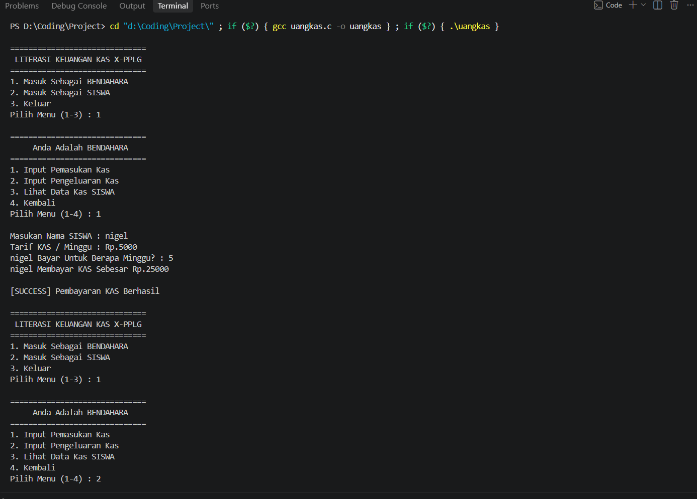
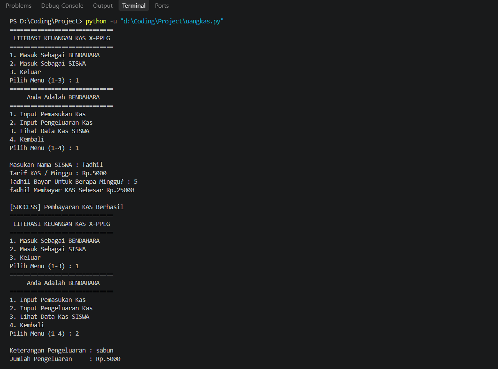

# Aplikasi Literasi Uang Kas
Project Ujian Tengah Semester (UTS) mata pelajaran Pemrograman Dasar /
Koding & Kecerdasan Artifisial kelas X PPLG. Aplikasi ini dibuat dalam
dua versi bahasa pemrograman, yaitu **C** dan **Python**.
## Identitas Siswa
* **Nama Lengkap:** Nigel Revandha Kaylov
* **Kelas:** X PPLG
* **No. Absen:** 25
## Deskripsi Aplikasi
Aplikasi ini berfungsi sebagai liteasi Keuangan Kas X-PPLG. Fitur sebagai Bendahara adalah memasukkan input pemasukan dan pengeluaran Kas X-PPLG dan melihat data Kas Siswa X-PPLG. Fitur sebagai Siswa hanya melihat data Kas Siswa X-PPLG. 
## Daftar File
* `uangkas.c`                 : Kode program utama menggunakan bahasa C.
* `uangkas.py`                : Kode program utama menggunakan bahasa Python.
* `output_uangkas_C.png`      : Screenshot hasil menjalankan program aplikasi. (Bahasa C).
* `output_uangkas_python.png` : Screenshot hasil menjalankan program aplikasi. (Bahasa Python).
## Screenshot Output Program

